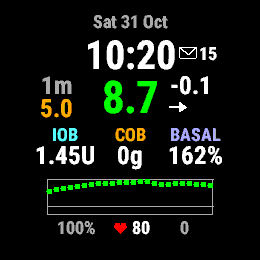

# AAPS Push Watch Face (V2 Push-to-Pull)

> **Use it at your own risk.** This is not a medical device. Never make a medical decision
> based on a value you see on your watch - always check AAPS or your CGM.

A minimal Connect IQ watch face that shows AndroidAPS (AAPS) data. It gets the data with
**V2 Push-to-Pull**. AAPS sends a small "new data" signal to the watch, and the watch
then fetches the data itself over HTTP. Use it as a starting point for your own watch face.
To try it, copy a ready-built `.prg` from the `prg/` folder to your watch.



**Send steps (and heart rate) to AAPS:** hold the watch face → *Customize* → turn on
*Send steps to AAPS* (and *Send heart rate to AAPS*). Both are off by default. AAPS only
stores the steps if you use the fork branch (see below). Only one watch
should send steps to an AAPS.

It shows BG with delta and trend, the age of the reading, temporary target, IOB, COB and
basal / temp basal. When the loop is off, it shows LOOP OFF. It also shows time/date, a
2-hour BG graph, battery, heart rate and steps. The layout is computed from the watch's own
font sizes. So the same code fits every watch in the manifest: round watches from 218 to
466 px, and the square Venu Sq Music and Venu X1.

> **Push and steps need an AAPS build from the fork
> [Pwb0186/AndroidAPS](https://github.com/Pwb0186/AndroidAPS)**, branch
> [`GarminPush+Steps+Control-V4.0.0`](https://github.com/Pwb0186/AndroidAPS/tree/GarminPush+Steps+Control-V4.0.0)
> (on AAPS 4.0.0). This branch adds push (V2), steps, pump status and the extra `/get` fields.
> It also adds the commands for the [AAPS Control widget](https://github.com/Pwb0186/aaps-garmin-control-widget).
> These commands are off until you set a **Garmin remote control PIN** in AAPS.
>
> With stock AAPS the watch face still runs, but without push:
>
> | | Stock AAPS | Fork branch |
> |---|---|---|
> | BG, delta, trend, graph, IOB, basal | yes. Fetched on the watch's own timer. The fetch is planned a few seconds after AAPS should have the next reading (about every 5 min) | yes |
> | Update after a bolus, carbs, temp target or temp basal | at the next timer fetch (up to 5 min) | a few seconds (push) |
> | COB | from `/sgv.json`, one extra request per fetch | yes |
> | Temporary target, loop status (LOOP OFF) | not sent, so no TT and no loop on/off info | yes |
> | Steps to AAPS | ignored | yes |
> | Heart rate to AAPS | yes | yes |
>
> If an AAPS does not send a field, the field is just missing from the answer. The watch
> face handles that, and nothing breaks.

`Shared/` is based on Robert Buessow's [AAPS Glucose Applications](https://github.com/buessow/garmin).

---

## Folder layout

```
PushWatchFace/   the watch face itself (app, view, manifest, resources)
Shared/          AAPS communication, data model, graph, scheduling - based on Buessow's
                 code and changed for V2; your own watch face uses it unchanged
prg/             ready-built release .prg for every watch in the manifest, to try it
```

`PushWatchFace/monkey.jungle` pulls in `../Shared/source` and `../Shared/resources`.
So keep the two folders next to each other. Your own watch face goes in a new folder
beside them and uses the same `monkey.jungle` lines.

---

## How it works

```
AAPS (phone)                                     Watch
    |  new BG, or the loop changed something         |
    |--- CIQ message {key, "updateWatch"} ---------->|  wakes the background process
    |                                                |  GlucoseServiceDelegate.onPhoneAppMessage()
    |                                                |  (routed by Garmin Connect on the phone)
    |<-- HTTP GET 127.0.0.1:28891/get?appId=... -----|  
    |                                                |
    |--- JSON: BG history, IOB, COB, TBR, TT ... --->|
    |                                                |  App.onBackgroundData() -> redraw
```

- **AAPS pushes** on a new BG reading. It also pushes on boluses, carbs, temp basal,
  temp target and running-mode changes. AAPS waits 3.5 s for more changes (debounce), so
  one loop cycle gives one push. The push is sent at once. Sometimes AAPS has no COB value
  yet, for example just after AAPS starts, before its first calculation. Then it leaves
  `carbsOnBoard` out of the answer, and the watch keeps the value it has.
- **AAPS only pushes to apps it has heard from.** Every `/get` carries the app's
  `appId`. AAPS keeps a list of up to 10 app ids. It pushes to those that fetched
  within the last 15 minutes. A new watch face is registered by its first fetch.
- **The watch has its own fallback fetch.** Garmin allows one background run per 5
  minutes. While push works, the fallback is planned 60 s after the next expected BG. It
  is cancelled when a push delivers the data first, so normally it never runs. If the
  pushes stop, the fallback still runs at +60 s, about every 5 minutes. When no push has
  come for 15 minutes (about three readings), it moves to 5 s after the expected BG. That
  is plain polling every 5 minutes.
- **The background plans its next fetch itself.** The timer is a one-shot event. The
  watch face plans it only while it is on the screen and the phone is connected. So every
  background run (timer and push) also plans the next one, about 6 minutes ahead. This
  way the watch face keeps fetching during an activity, when the activity has the screen.
  It also keeps trying without the phone. While the watch face is on the screen and the
  phone is connected, the watch face's own time replaces that one. Garmin only runs the
  background of the selected watch face. A watch face that is not selected does not fetch.

---

## Checklist for your own watch face

Copy `PushWatchFace` to a new folder and go through this list. Items 1-5 are required.
Without them, push will not work, or it will go to the wrong watch face.

### 1. A new, unique App ID - in two places

Generate a new UUID and write it **without dashes** (32 hex characters). It must be
identical in:

- `manifest.xml`: `<iq:application id="...">`
- `PushWatchFaceApp.mc` (the app class), in `getInitialView()`: `Properties.setValue("AppId", "...")`

AAPS pushes to the `appId` the watch sends with `/get`. Connect IQ delivers the push
to the app with the same id in its manifest. If the two differ, the watch fetches fine but
never receives a push. Never reuse this watch face's id. AAPS pushes by id, and Connect IQ
delivers by id. So two watch faces with the same id disturb each other.
AAPS only accepts ids of exactly 32 hex characters.

Also give the app its own name in `resources/strings/strings.xml` (`AppName`).

### 2. Identify the app to AAPS (`getInitialView()`)

```monkeyc
Properties.setValue("Device", System.getDeviceSettings().partNumber + "_MYFACE");
Properties.setValue("AppVersion", "myface_v1");      // free text, shows in the AAPS log
Properties.setValue("AppId", "YOUR_APP_ID");         // the id from manifest.xml, 32 hex characters
server.init2();
```

`HttpClient` sends `device`, `version` and `appId` with every request.
`server.init2()` does two things. First, it schedules the first background fetch as soon
as Garmin allows. That fetch registers the app in AAPS. Second, it sets the **drain** flag
(item 4).

### 3. Register for push - delete first, then register

```monkeyc
try {
  Background.deletePhoneAppMessageEvent();
} catch (e) {
  // nothing registered - not an error
}
Background.registerForPhoneAppMessageEvent();
```

Do this in `getInitialView()`, that is, on every foreground start. For example: the watch
face is selected, the watch is restarted, or an activity has ended. Sometimes a plain
`register` did nothing. This happened when an old registration was still there after the
watch face had been inactive for a while. Fetching started again, but push did not work
until the app was reinstalled. Deleting first gives a fresh registration.

### 4. Drain waiting phone messages (handled by `Shared`)

The watch keeps phone messages for an app until the app takes them. A watch face that is
not active never takes them. AAPS keeps pushing to it until it leaves the 15-minute
window. These messages collect, and the watch can run out of message storage for the app.
After a foreground start, the first background run takes all waiting messages and drops
them, once. This is done by `GlucoseServiceDelegate.drainPhoneAppMessagesOnce()`.

You get this automatically when you call `server.init2()` (item 2). The number of drained
messages is sent to AAPS as `drained=N` on that fetch. Don't try to drain from the
foreground. There, `Toybox.Communications` is not available to a watch face, and the
error can't be caught.

### 5. The app class: background annotation, service delegate, background data

```monkeyc
(:background)
class MyWatchFaceApp extends Application.AppBase {
  function initialize() {
    AppBase.initialize();
    server = new Shared.GmwServer();
  }

  function getServiceDelegate() as [ System.ServiceDelegate ] {
    return [ server.createServiceDelegate() ];
  }

  function onBackgroundData(result) as Void {
    if (data == null) { data = new Shared.Data(); }
    server.onBackgroundData(result, data);           // parse; marks push as working
    if (result instanceof Dictionary && "http".equals(result["channel"])) {
      BackgroundScheduler.backgroundComplete(data.glucoseBuffer.getLastDateSec());
    }
    if (view != null) { view.onDataUpdated(); }
  }
}
```

- The class must be `(:background)`, otherwise the background process can't start it.
- Call `server.onBackgroundData()` **before** `BackgroundScheduler.backgroundComplete()`.
  The first records that push delivered data, so the fallback does not disturb push. The
  second plans the next fallback.

### 6. Manifest permissions

```xml
<iq:uses-permission id="Background"/>      <!-- push and background fetch -->
<iq:uses-permission id="Communications"/>  <!-- HTTP to AAPS -->
<iq:uses-permission id="SensorHistory"/>   <!-- only if you send heart rate -->
```

### 7. `monkey.jungle`

```
project.manifest = manifest.xml
base.sourcePath = source;../Shared/source
base.resourcePath = resources;../Shared/resources
base.excludeAnnotations = datafield
```

`base.excludeAnnotations = datafield` leaves out the code in `Shared` that only a data
field uses (see [Developer notes](#developer-notes)). `Shared/resources` adds the `AAPSKey` setting and the properties `Shared` uses. Your own
`resources/settings/properties.xml` is merged with it.

### 8. Optional: heart rate and steps to AAPS

Both are **off by default** in PushWatchFace. The user switches them on in the watch menu
(item 9). Some AAPS loops read them. For example, OpenAPS AIMI can reduce SMB when the
steps are high. So the user must choose to send them.

- **Steps** (`steps=`, today's total, at most every 4 minutes) are sent when
  `SendStepsToAaps` is true. With `PauseStepsInActivity`, they are held back while an
  activity is started, paused or not yet saved. This is when
  `Activity.getActivityInfo().timerState` is above 0. The background process reads it,
  because the watch face itself does not run during an activity. The activity's steps are
  then never sent.
- **Heart rate** is sent when `SendHeartRateToAaps` is true. Just before each request, the
  background process reads it from the watch's heart rate history (about one sample a
  minute). This is done in `populateHeartRateHistory()` in
  `Shared/source/GlucoseServiceDelegate.mc`. It sends the average since the last value
  AAPS accepted as `hr`. This covers up to 10 minutes. If the last value is older, it
  covers the last 5 minutes. It also sends `hrStart` (the last `hrEnd`) and `hrEnd` (time
  of the newest sample). So the periods follow each other without overlap. The background
  can read it while an activity runs, when the watch face itself does not run.
  `PauseHeartRateInActivity` is on by default. It holds the heart rate back while an
  activity is started, paused or not yet saved. A data field in the activity usually sends
  it then. Turn it off in the watch menu to send it anyway.

AAPS only stores the steps with the fork branch. Stock AAPS ignores them.
**Only one watch should send steps to an AAPS.** AAPS keeps only one last total. So if a
second watch has a higher total, the difference is counted as steps. When you switch watch, wait at least
12 minutes after the last steps were sent, or turn off "Send steps to AAPS" on one of them.

`Shared` reads both with `Util.settingOn(key, default)`. It gives the default when the
property does not exist. So a watch face without these properties keeps working. PushWatchFace
defines both as `false` in `properties.xml`.

#### How the steps code works

Everything is in `Shared/source/GlucoseServiceDelegate.mc`. It runs in the background
process, just before each `/get` request. The function is `populateSteps()`, and it is
called while the request parameters are built:

1. **Switched on?** `Util.settingOn("SendStepsToAaps", true)` reads the property. A missing
   property gives the default, so a watch face without it keeps working. PushWatchFace sets
   it to `false` in `resources/settings/properties.xml`, and the watch menu
   (`PushWatchFaceSettings.mc`) switches it on.
2. **Activity running?** If `PauseStepsInActivity` is on, `isActivityRunning()` reads
   `Activity.getActivityInfo().timerState`. Above 0 means the activity is started, paused
   or not yet saved. Then no steps are sent. Every call is protected with `has` checks and
   `try/catch`. On a device that refuses the call, it returns `false`, and the steps are
   sent as usual.
3. **At most every 4 minutes:** the time of the last accepted send is kept in `Storage`
   (`LastSentStepsSec`). Within 240 s nothing is sent.
4. **Read and send:** `ActivityMonitor.getInfo().steps` (today's total, reset by the watch
   at midnight) is added as `steps=<total>`.
5. **Only after AAPS accepted it:** `LastSentStepsSec` is saved only when the answer is
   HTTP 200. So a failed request is tried again at the next fetch.
6. **Kept while AAPS can't be reached:** sometimes a `/get` with steps gets no HTTP 200.
   For example, there is no phone, or AAPS or its Garmin plugin is off. Then the total and
   its time are kept in `Storage` (`StepSamples`). It keeps at most 36 samples, at least
   240 s apart, which is about 3 hours. The next `/get` with steps also sends them as
   `stepsPrev=<sec>:<total>,<sec>:<total>,...` (oldest first). They are deleted when that
   request gets HTTP 200. They are also deleted when *Send steps to AAPS* is off. Only an
   AAPS from the fork branch with this change uses `stepsPrev`. With it, the steps in the
   gap get their own time. An older AAPS ignores the field.

The watch sends only the day's total. AAPS (`GarminSteps` in the fork) turns the difference
from the last total into the 5/10/15/30/60/180-minute windows. It also handles midnight and
a counter that drops. Over a gap of more than 12 minutes, it stores no steps, only a new
starting point. The exception is when `stepsPrev` fills the gap (item 6).

To send steps from your own watch face, use `Shared` as it is. Add a boolean property
`SendStepsToAaps` (and optionally `PauseStepsInActivity`) to your `properties.xml`. Then give
the user a way to change it, for example a watch menu or Connect IQ settings.

### 9. Optional: settings on the watch

Garmin Connect shows no settings page for a sideloaded `.prg`. So PushWatchFace has a
menu on the watch (hold the watch face > Customize). In the menu you set the low and high
BG marks, which are used for the BG colour and the graph lines. You can also show or hide
the heart rate. And you can turn on sending steps and heart rate to AAPS, and holding them
back during an activity. See
`getSettingsView()` in the app class and
`PushWatchFaceSettings.mc`.

---

## AAPS settings

In AAPS, go to *Configuration -> Communication -> Garmin* and enable it. In its settings,
enable the **local HTTP server**. The default port is 28891, and the watch uses that port.

**AAPS key** (optional, **Request Key** in the same AAPS settings):

- **No key in AAPS:** everything works, also with a sideloaded `.prg`.
- **With a key:** enter the same key in the watch face's settings in the Garmin Connect
  app on the phone. That settings page only exists when the watch face is installed from
  the Connect IQ Store (a beta upload is enough). A sideloaded `.prg` has no settings
  page, so leave the key empty in AAPS. With a missing or wrong key AAPS answers 401, and
  the watch face is never registered for push.
- **Key changed in AAPS later:** with the fork branch the key does not have to be
  entered again on the watch. AAPS sends the new key at once with a push, and also with
  every new BG. The watch face saves the key when a fetch with it is accepted. This only works
  if the watch face fetched data within the 15 minutes before the change. With stock AAPS
  there is no push, so the key must be entered again.

---

## The HTTP interface

Request - `GET http://127.0.0.1:28891/get?...`

| Parameter | Sent by | Meaning |
|---|---|---|
| `appId` | always | 32 hex chars; registers the app for push |
| `key` | always | AAPS key (empty if none set) |
| `device`, `version`, `manufacturer` | always | shows in the AAPS log |
| `trig` | always | `push` or `timer` - what started this fetch |
| `drained` | first fetch after foreground start | number of waiting messages dropped |
| `pusherr` | after an error | last `PhoneAppMessageError` code |
| `steps` | max every 4 min, only if enabled in the watch menu | today's total steps |
| `stepsPrev` | with `steps`, only after requests that failed | totals kept on the watch while AAPS could not be reached. Format `<sec>:<total>,...`, oldest first (epoch sec). An AAPS without this change ignores it |
| `hr`, `hrStart`, `hrEnd` | max every 4 min, only if enabled in the watch menu | average heart rate since the last one sent (max 10 min) and its period (epoch sec) |

Response (JSON):

| Field | Meaning |
|---|---|
| `encodedGlucose` | about the last 2 h of BG, as delta-var encoded pairs (epoch sec, mg/dL) - `Shared.DeltaVarEncoder` |
| `remainingInsulin`, `remainingBasalInsulin` | bolus IOB and basal IOB (U); total IOB is the sum of the two |
| `carbsOnBoard` | COB (g). **Left out while AAPS recalculates.** Keep the last value then. Sent by the fork branch only. When the answer has no `loopEnabled` (stock AAPS), `Shared` gets `cob` from `/sgv.json?count=1&brief_mode=true` in a second request (`onGetResult` in `GlucoseServiceDelegate.mc`) |
| `temporaryBasalRate` | running temp basal as a fraction of the profile basal (`1.0` = 100 %, `0.0` = zero temp). Left out when no temp basal runs |
| `temporaryTargetActive` | `true`/`false`; when true also `temporaryTargetLow`, `temporaryTargetHigh` (mg/dL), `temporaryTargetReason`, `temporaryTargetEndSec`, `temporaryTargetDurationMin` |
| `lowGlucoseMark`, `highGlucoseMark` | low and high mark from the AAPS Overview settings (mg/dL); left out when 0. PushWatchFace does not use them. It has its own marks (item 9) |
| `glucoseUnit` | `mmoll` or `mgdl` - display unit chosen in AAPS |
| `connected`, `loopEnabled` | pump connected, loop running |
| `timestamp` | server time (epoch sec). `Shared.GmwServer` drops responses older than the last one. A stored time more than 10 min ahead of the watch's clock is reset |
| `profile` | active profile name |

---

## Build and install

**To try it without building:** `prg/` has a release build for every watch in the
manifest (`PushWatchFace-<device>.prg`). Copy the one for your watch to `GARMIN\APPS`
(see below) and pick "AAPS Push" as the watch face. To change anything, build it
yourself.

Requirements: Connect IQ SDK (built with 9.2.0; `minSdkVersion` 3.3.1) and a Connect IQ
developer key (SDK Manager / VS Code: "Generate a Developer Key").

**Command line**, from the repository root:

```
monkeyc -o PushWatchFace/bin/PushWatchFace.prg -f PushWatchFace/monkey.jungle -y <your developer key> -d <device> -w -r
```

`<device>` is a device id from `PushWatchFace/manifest.xml`, for example `fr955`. `-r`
makes a release build without the log output from `Shared/Log.mc`. Leave it out when
you want to read the log. Then create an empty `GARMIN\APPS\LOGS\PushWatchFace.TXT` on
the watch, and the log is written there.

**VS Code:** with the Monkey C extension, open the `PushWatchFace` folder and use
"Monkey C: Build for Device" (or "Run" for the simulator). The simulator gets no push,
because push goes through Garmin Connect on the phone.

**Install (sideload):** connect the watch by USB and copy the `.prg` to `GARMIN\APPS`,
then pick "AAPS Push" as the watch face on the watch. A sideloaded `.prg` can't use an AAPS key (see
AAPS settings).

The supported devices are listed in `manifest.xml`: 68 watches. Most are round Garmin
watches with Connect IQ 3.3.1 or newer, plus the square Venu Sq Music and Venu X1.
The layout is built from
system fonts and screen size, not fixed pixel positions. It has been tested on a real
Forerunner 955. The other watches build, but they have only been checked in the
simulator, or not at all.

---

## Troubleshooting

Filter the phone's logcat on the Garmin tag:

```
adb logcat -v time -s GARMIN:V
```

| You see | Meaning |
|---|---|
| `get from ... req: /get?...appId=<your id>...&trig=push` | push works |
| only `trig=timer`, every 5 min | the watch fetches but gets no push. Check the App ID in both places (item 1). Then switch to another watch face and back (item 3) |
| only `trig=timer` after a sideloaded `.prg` was replaced by the store version (same App ID) | switch to another watch face and back once. Push starts after that foreground start. A fresh store install or a store update gets push right away. The watch face's name in the watch list only changes at the next switch (this is only visual) |
| `Ignoring malformed appId` | the App ID is not 32 hex characters |
| `Invalid AAPS Key` | key in the watch face differs from the one in AAPS |
| `no answer for ... after 20s, resending` | the watch did not fetch after a push, so AAPS sends once more. This is normal if it happens now and then |
| no `/get` at all | local HTTP server off in AAPS, or Garmin Connect not running on the phone |
| watch shows `--` after the Garmin plugin or AAPS was off for more than 15 min | AAPS only pushes to watch faces that fetched in the last 15 min. The watch fetches again by itself within about 5 min. This registers it again and restarts push. To fetch at once, switch to another watch face and back |

---

## Developer notes

`Shared` is also used by a private data field, which has little memory. Code that only
one side uses is annotated and excluded in `monkey.jungle` (`base.excludeAnnotations`):

| Annotation | Used by | Excluded here |
|---|---|---|
| `(:watchface)` | watch faces (push, steps, heart rate from the watch's history, COB from `/sgv.json`, planning the next background run, ...) | no |
| `(:datafield)` | the data field only (foreground fetch, heart rate from the activity, ...) | yes: `base.excludeAnnotations = datafield` |

Where both sides need a member with different code, there are two versions with the same
name, one `(:watchface)` and one `(:datafield)`. Keep the `datafield` line in your own
watch face's `monkey.jungle`. Otherwise both versions are compiled, and they clash.

---

## Credits

`Shared/` is based on Robert Buessow's
[AAPS Glucose Applications](https://github.com/buessow/garmin) (MIT License). This
repository is MIT licensed as well; see [LICENSE](LICENSE).
